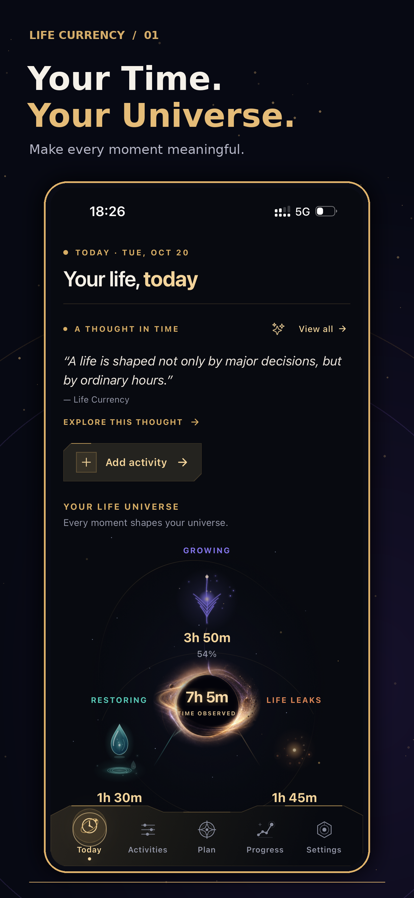
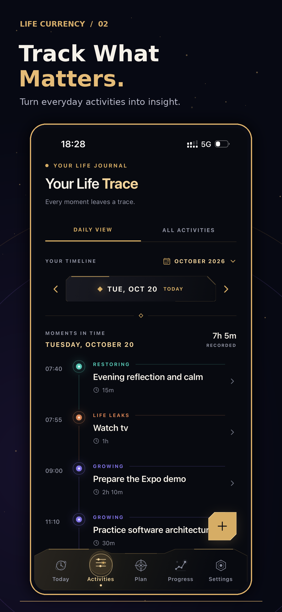
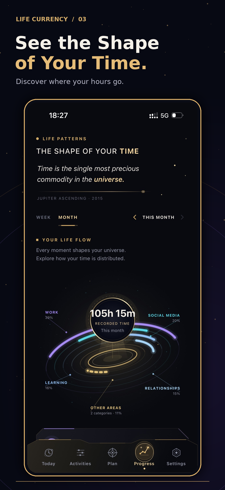
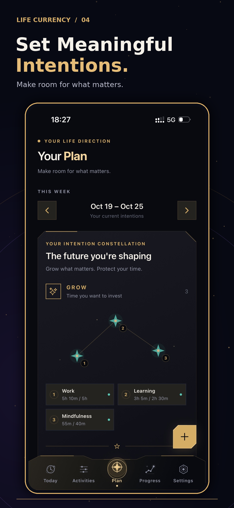
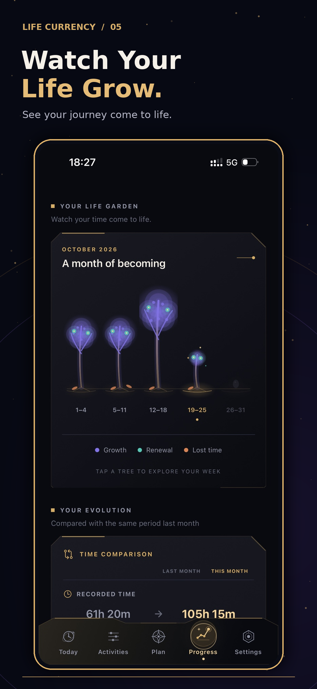
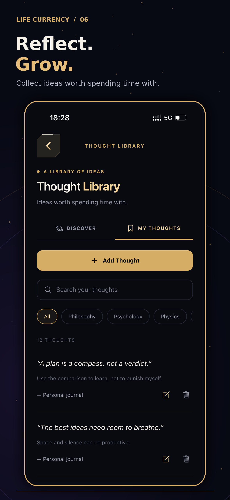

# Life Currency 🌌

### Make your time visible.

Life Currency is a cross-platform mobile application designed to help people understand how they spend their time, track meaningful activities, and reflect on their daily experiences.

Built independently using React Native, Expo, and TypeScript.

**Status:** iOS submitted for App Store review · Android release in preparation

---

> **Portfolio Showcase**
>
> This is a public showcase of Life Currency, an independently developed React Native application. The production source code is maintained in a private repository.

---

## Overview

Life Currency transforms everyday activities into visual insights.

Instead of focusing exclusively on productivity, the application encourages users to become more aware of how they allocate their time.

The experience combines activity tracking, interactive visualizations, weekly planning, and personal reflection.

## Screenshots

A preview of the Life Currency mobile experience.

  

  

  

  

  

  

---

## Video Demonstration

[▶ Watch Life Currency Demo](Presentation.mov)

---

## Key Features

### Activity Tracking
- Create, edit, and delete activities.
- Organize activities into categories.
- Track time spent on different aspects of daily life.
- Review activity history.

### Visual Analytics
- Explore time distribution across categories.
- Interactive category-based visualizations.
- Animated progress indicators.
- Responsive layouts for different screen sizes.

### Weekly Intentions
- Set intentions for the week.
- Organize personal priorities.
- Reflect on how time is allocated.

### Personal Reflection
- Record daily reflections.
- Explore philosophical ideas through the Thought Library.
- Encourage mindful engagement with daily experiences.

### Local-First Experience
- SQLite-based local data persistence.
- No account registration required.
- Core functionality available without a backend service.

---

## Tech Stack

| Area | Technologies |
|------|-------------|
| Mobile Framework | React Native, Expo |
| Language | TypeScript |
| Navigation | Expo Router |
| Database | SQLite |
| Styling | NativeWind |
| Animations | React Native Reanimated |
| Forms & Validation | React Hook Form, Zod |
| iOS Distribution | EAS Build, EAS Submit, TestFlight, App Store Connect |
| Android Distribution | Google Play Console (in progress) |

---

## Architecture

Life Currency follows a modular, feature-oriented application structure.

The codebase separates:

- Feature-specific screens and components
- Shared UI components
- Database operations and migrations
- Application state and business logic
- Reusable hooks and utilities
- Theme and layout configuration

This approach supports maintainability, code reuse, and independent feature development.

### Technical Highlights

**Local Data Persistence**

Activity data is stored locally using SQLite, with schema migrations supporting application evolution.

**Interactive Mobile Interfaces**

Custom animations and visualizations are implemented using React Native Reanimated and reusable UI components.

**Responsive Design**

Layouts and interaction patterns are adapted for different iPhone screen sizes.

**Mobile Release Workflow**

The iOS application has been built, distributed through TestFlight, tested on a physical device, and submitted for App Store review.

---

## Screenshots

Screenshots and a short demonstration video will be added here.

---

## Development

Life Currency is an independently designed and developed application.

My responsibilities include:

- Application architecture
- React Native development
- UI component design and implementation
- Local database design
- Feature development
- Testing and debugging
- iOS build and distribution workflows
- App Store submission

---

## Availability

**iOS:** Submitted for App Store review.

**Android:** In preparation.

The application will be available through official app stores following approval.

---

## Source Code & Access

**Life Currency is a proprietary, independently developed application.**

This repository serves as a public portfolio showcase and contains project documentation, screenshots, and a demonstration video.

The complete React Native source code is maintained in a **separate private repository** and is not publicly accessible.

The application is not currently open source.

I am happy to discuss the application's architecture, implementation decisions, technical challenges, and development process during interviews.

**Development status:**

- iOS: Submitted for App Store review.

- Android: Release preparation in progress.

---

## Engineering Decisions

Life Currency was independently designed and developed, with a focus on maintainability, performance, and a consistent mobile user experience.

### Feature-Oriented Architecture

The application follows a modular, feature-oriented architecture rather than organizing the entire codebase by technical layers alone.

Each feature encapsulates its screens, components, and related logic, while reusable UI elements, hooks, and utilities are shared across the application.

**Why this approach?**
- Keeps features isolated and easier to maintain.
- Reduces coupling between unrelated parts of the application.
- Encourages reusable components and consistent UI patterns.
- Supports incremental development without requiring large-scale restructuring.

### Local-First Data Architecture

SQLite was selected as the primary persistence layer for activity tracking and related user data.

The application does not require users to create accounts or depend on a remote backend for its core functionality.

**Why SQLite?**
- Enables offline access to locally stored data.
- Provides structured storage for activities and categories.
- Supports efficient querying and aggregation for time-based insights.
- Avoids unnecessary network requests and backend infrastructure.

Database schema changes are managed through versioned migrations.

### Interactive Visualizations

Rather than relying exclusively on standard charts, Life Currency uses custom visual components to represent time allocation and personal progress.

React Native Reanimated supports animated transitions and interactive UI elements.

**Engineering considerations:**
- Keeping animations responsive without interfering with user interactions.
- Separating visual presentation from activity data and calculations.
- Reusing visual components across different screens.
- Adapting complex layouts to smaller mobile devices.

### Type Safety and Form Validation

TypeScript is used throughout the application to improve maintainability and reduce runtime errors.

React Hook Form and Zod provide structured form handling and validation.

**Why this combination?**
- Explicit data contracts and predictable form state.
- Consistent validation rules.
- Better maintainability as application features evolve.
- Clearer separation between user input and persistence logic.

### Responsive Mobile UI

The application includes custom layouts, reusable components, and responsive styling using NativeWind.

Special attention was given to:
- Different iPhone screen sizes.
- Touch target accessibility and interactive elements.
- Confirmation dialogs and destructive actions.
- Consistent spacing, typography, and visual hierarchy.

### Build, Testing & Distribution

The iOS release workflow uses Expo Application Services (EAS), TestFlight, and App Store Connect.

The application has been tested on a physical iPhone and submitted for App Store review.

This process includes:
- Production build configuration.
- Build version management.
- TestFlight distribution.
- Physical-device testing and UI verification.
- App Store submission and review communication.

Android distribution is currently being prepared.

---

## Developer

**Sanja Mandic**

Software Engineer | React Native · TypeScript · Full-Stack Development

[GitHub](https://github.com/Sanja969)
